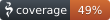

# Template

---
{width="300" .center}

<!-- markdownlint-disable MD033 -->
<!--

---
Descrição sobre o projeto
---

  <a  class="card" href="./_01_tutorial/" taget="_blank">
       
      <h5 class="title-card-h5" >Tutorial!</h5>
       
  </a>

  <a class="card" href="./_02_comandos" taget="_blank">
       
      <h5 class="title-card-h5">Comandos!</h5>
       
  </a>

  <a  class="card" href="app/api/integration/integration" taget="_blank">
      <h5 class="title-card-h5">Integração!</h5>
      
    

-->